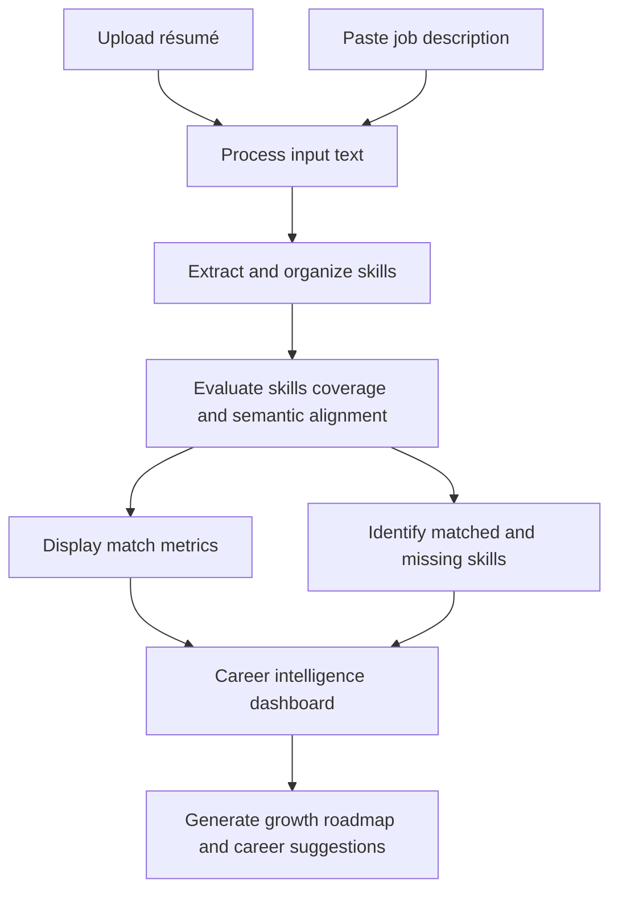

<div align="center">

# 🚀 CVBoost

### AI-Powered Resume Matching, Skill Gap Analysis & Career Roadmaps

**Your next move, made clearer.**

CVBoost is a career intelligence application that compares a candidate's résumé with a target job description, highlights aligned and missing skills, and provides actionable recommendations for professional development.

[](https://github.com/Satbiest/project-netlify1)


[**Explore the Repository**](https://github.com/Satbiest/project-netlify1) · [**Other Data Project: Kudata**](https://github.com/Satbiest/kudata)

</div>

---

## 📌 Table of Contents

- [Project Overview](#-project-overview)
- [Problem Statement & Objectives](#-problem-statement--objectives)
- [Key Features](#-key-features)
- [Application Screenshots](#-application-screenshots)
- [How CVBoost Works](#-how-cvboost-works)
- [Understanding the Analysis](#-understanding-the-analysis)
- [Technology Stack](#-technology-stack)
- [Getting Started](#-getting-started)
- [Project Files](#-project-files)
- [Future Improvements](#-future-improvements)
- [Author](#-author)

## 📖 Project Overview

**CVBoost** helps job seekers make more informed career decisions by translating the differences between a résumé and a job posting into clear, structured feedback. Instead of relying only on manual keyword checks, the project explores semantic similarity and AI-assisted recommendations to communicate **job fit**, **existing strengths**, **skill gaps**, and **learning priorities**.

The application is designed around a simple workflow: **upload a résumé → paste a job description → analyze alignment → explore a growth roadmap**.

### What the user receives

| Output | Purpose |
|---|---|
| **Overall match score** | Quick view of alignment between the résumé and the target role. |
| **Required skills coverage** | Identifies how well the résumé addresses the job's required competencies. |
| **Preferred skills coverage** | Highlights alignment with additional or nice-to-have qualifications. |
| **Semantic matching signal** | Provides a text-similarity perspective beyond exact keyword matches. |
| **Matched skills** | Shows skills detected as aligned with the target role. |
| **Skills to improve** | Highlights missing or less-evident competencies to develop. |
| **Personalized growth roadmap** | Suggests learning priorities and next steps. |
| **Related career paths** | Surfaces adjacent roles worth exploring. |

## 🎯 Problem Statement & Objectives

### The challenge

Job descriptions often combine technical requirements, preferred qualifications, and experience expectations. Candidates may struggle to assess whether their résumé communicates the right capabilities and which skills would most improve their readiness.

### Project objectives

1. **Analyze résumé–job alignment** in a structured and understandable way.
2. **Identify matched and missing competencies** from the information provided.
3. **Complement keyword comparison with semantic matching** to capture related terminology.
4. **Translate analysis into practical learning recommendations** rather than a score alone.
5. **Present the results through a user-friendly interface** that supports career exploration.

## ✨ Key Features

### 1. Résumé & job description input

- Upload a résumé and provide a target job description.
- Initiate an analysis from one clear workflow.
- Review match results without manually comparing each requirement.

### 2. Multi-dimensional match overview

- Overall match percentage.
- Required-skills and preferred-skills indicators.
- Semantic matching indicator, presented alongside skills coverage.

### 3. Skills gap breakdown

- Clearly separated **Matched Skills** and **Skills to Improve** sections.
- Skill categories in the example include programming languages, data analytics, databases, tools, and soft skills.
- Makes it easier to decide which strengths to showcase or develop.

### 4. Personalized growth roadmap

- Recommends skill-development priorities based on the target role.
- Provides next steps that connect missing skills with suggested learning activities.
- Introduces additional career paths that may fit the candidate's profile.

## 🖼️ Application Screenshots

> The following screenshots are supplied from the CVBoost interface. Example scores and recommendations are illustrative results of the displayed résumé and job description, **not guaranteed outcomes for other users**.

### 1. Dashboard — Your match at a glance

The central dashboard presents the overall score and supporting indicators after the user uploads a résumé and enters a job description.


### 2. Match analysis — Detailed scoring indicators

The results screen breaks down the analysis into overall match, required skills, preferred skills, and semantic matching signals.


### 3. Skill gap analysis — Matched vs. missing skills

Skill chips group detected competencies and highlight areas for improvement, making the assessment easier to act on.


### 4. Growth roadmap — Next steps & related career paths

The roadmap turns analysis into a practical learning direction and surfaces adjacent roles to consider.


## 🔄 How CVBoost Works



**Conceptual workflow:** The diagram summarizes the user-visible processing stages and project approach; it is not a claim about exact internal module names or deployment architecture.

## 📊 Understanding the Analysis

A screenshot in this repository shows the following **example** for a *Data Analyst* job description:

| Metric displayed | Example value | Interpretation |
|---|---:|---|
| Overall match score | **71.7%** | Summary indicator of résumé–role alignment. |
| Required skills | **100.0%** | Displayed coverage of required skills for this example. |
| Preferred skills | **33.3%** | Displayed coverage of preferred qualifications for this example. |
| Semantic embedding | **50.1** | Additional semantic matching signal displayed by the interface. |

The skill analysis example includes competencies such as **Python, SQL, Power BI, Excel, data analysis, data visualization, and communication**, alongside improvement areas such as **Git** and **GitHub**.

> **Important:** These are UI examples, not benchmark results or independently validated accuracy measurements. A match percentage should not be treated as a probability of being hired. The exact score formula, weights, calibration, and model evaluation should be documented from the implementation before making quantitative performance claims.

## 🛠️ Technology Stack

The project has been developed around the following technologies, as described in the project background. The exact versions, dependencies, and production configuration should be checked against the repository manifests.

| Area | Technology | Role |
|---|---|---|
| Programming | **Python** | Data processing and analysis logic. |
| API / Backend | **FastAPI** | Backend API and orchestration. |
| NLP / Similarity | **Sentence-BERT (SBERT)** | Semantic text representations and similarity comparison. |
| Generative AI | **Google Gemini** | AI-assisted recommendations and roadmap content. |
| UI Styling | **Tailwind CSS** | Responsive application styling. |
| Version Control | **Git & GitHub** | Source management and collaboration. |

> Model names and implementation details may vary between development iterations. Confirm any currently used Gemini model, frontend framework, and hosting platform from the source code before presenting them as final deployment specifications.

## 🚀 Getting Started

### Prerequisites

- **Git** for cloning the repository.
- **Node.js / npm** if the frontend includes a `package.json`.
- **Python** if the backend includes a Python dependency manifest (such as `requirements.txt` or `pyproject.toml`).
- Any API credentials required by the AI backend, stored securely in environment variables rather than committed to the repository.

### 1. Clone the repository

```bash
git clone https://github.com/Satbiest/project-netlify1.git
cd project-netlify1
```

### 2. Inspect the available application scripts

The start commands depend on the current repository structure. Check the `scripts` section of `package.json` (if present) and any backend entry point before proceeding.

**For a Node-based frontend, if `package.json` exists:**

```bash
npm install
npm run dev
```

The `npm run dev` command works only if the project defines a `dev` script. If it does not, use the script specified in that project's `package.json`.

**For a Python backend, if it includes `requirements.txt`:**

```bash
python -m venv .venv
# Activate the virtual environment for your operating system
pip install -r requirements.txt
```

Launch the backend with its actual documented server entry point. Avoid guessing an ASGI import path or exposing API keys in the frontend.

### 3. Configure credentials (if required)

Use a local environment file excluded from version control. For example, a backend may need a Gemini API key; the **exact variable name must match the application code**. Never commit real secrets, `.env` files, or uploaded résumés containing personal information.

### 4. Run an analysis

1. Open the application.
2. Upload a résumé in a supported format.
3. Paste the target job description.
4. Select **Process**.
5. Explore the match metrics, skills gap, and growth roadmap.

## 📂 Project Files

The accompanying documentation bundle provides these assets for the GitHub README:

```text
project-netlify1/
├── README.md
└── assets/
    └── screenshots/
        ├── cvboost-overview.png
        ├── cvboost-match-analysis.png
        ├── cvboost-skills-gap.png
        └── cvboost-growth-roadmap.png
```

> This tree describes **files supplied in the README bundle**, not an inventory of every source-code file currently in the GitHub repository. Preserve the application's existing source files when copying this bundle into the project.

## 🧭 Future Improvements

Potential enhancements to consider:

- [ ] Validate extraction accuracy on a labeled skill dataset.
- [ ] Explain the contribution and limitations of each match metric.
- [ ] Add downloadable PDF reports and structured export options.
- [ ] Support more résumé formats and job-posting sources.
- [ ] Add user-controlled roadmap priorities and progress tracking.
- [ ] Improve privacy safeguards for uploaded résumé data.
- [ ] Publish reproducible evaluation results, model versions, and deployment instructions.

## 👨‍💻 Author

**Satya Bintang Esa Resiadi**  
Data Analytics • Business Intelligence • Data Science

- GitHub: [@Satbiest](https://github.com/Satbiest)
- Project: [CVBoost](https://github.com/Satbiest/project-netlify1)
- Related portfolio project: [Kudata](https://github.com/Satbiest/kudata)

---

<div align="center">
  <strong>CVBoost — Turn skill gaps into actionable career growth.</strong>
</div>
